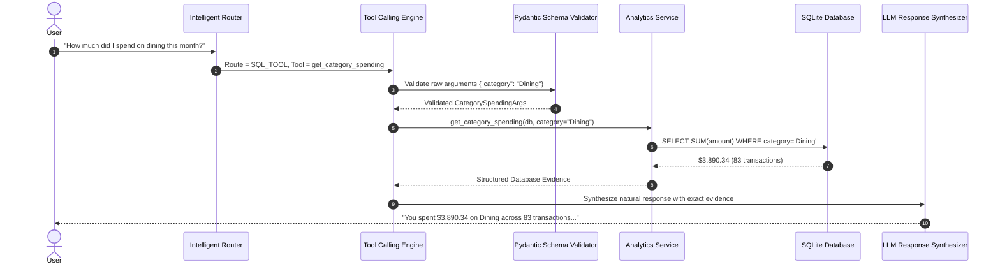
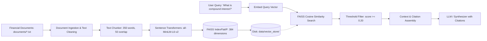
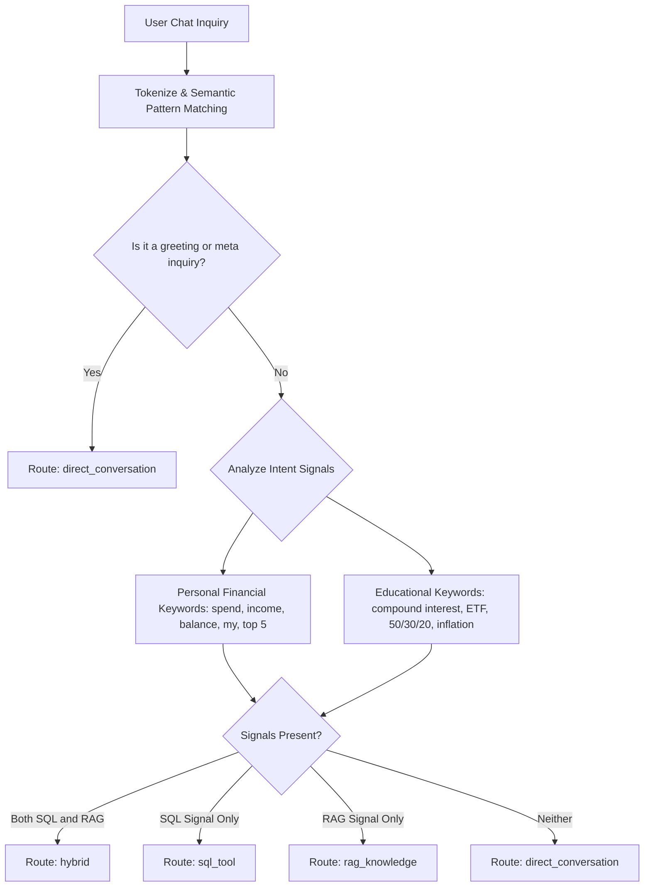

# FinQuery System Architecture & Technical Design

This document details the architectural principles, component interactions, data flows, and security boundaries of the **FinQuery — AI Financial Data Assistant** application.

---

## 1. High-Level System Architecture

FinQuery employs a decoupled, multi-tiered architecture that separates the Presentation Layer (Streamlit), Application/API Layer (FastAPI), Analytics & Tool Execution Layer (SQLAlchemy), Retrieval-Augmented Generation Layer (FAISS + SentenceTransformers), and LLM Orchestration Layer (Gemini SDK / Mock Engine).

```mermaid
flowchart TD
    User([User / Browser]) <--> StreamlitUI[Streamlit Frontend Dashboard & Chat]
    StreamlitUI <-->|HTTP REST / JSON| FastAPIServer[FastAPI Backend Server]

    subgraph API Layer
        FastAPIServer --> HealthRoute[/api/health]
        FastAPIServer --> TransRoute[/api/transactions]
        FastAPIServer --> AnalyticsRoute[/api/analytics]
        FastAPIServer --> ChatRoute[/api/chat]
        FastAPIServer --> RAGRoute[/api/rag]
    end

    subgraph Orchestration & Intelligence Layer
        ChatRoute --> Orchestrator[Financial Orchestrator]
        Orchestrator --> Router{Intelligent Question Router}
        Router -->|Personal Data Query| ToolEngine[Tool Calling Engine]
        Router -->|Financial Concept| RAGPipeline[RAG Pipeline]
        Router -->|Multi-part Query| HybridEngine[Hybrid Coordinator]
        Router -->|Greeting / Meta| DirectChat[Conversational Engine]
    end

    subgraph Data & Storage Layer
        ToolEngine -->|Pydantic Schema Validation| FinancialTools[Safe Financial Tools]
        FinancialTools --> AnalyticsService[Analytics Service]
        AnalyticsService --> SQLiteDB[(SQLite DB: finquery.db)]
        TransRoute --> TransactionService[Transaction Service]
        TransactionService --> SQLiteDB
    end

    subgraph Semantic Vector Layer
        RAGPipeline --> SentenceTransformer[Sentence Transformers: all-MiniLM-L6-v2]
        SentenceTransformer --> FAISSIndex[(FAISS Vector Store: faiss_index.bin)]
        FAISSIndex --> DocStore[(Document Metadata: chunks_metadata.json)]
    end

    subgraph LLM Synthesis
        ToolEngine -->|Evidence Dict| LLMSynthesizer[Gemini Client / Mock Synthesizer]
        RAGPipeline -->|Retrieved Context| LLMSynthesizer
        LLMSynthesizer --> FinalResponse[Grounded Response with Citations]
    end
```

---

## 2. Core Modules and Responsibilities

### 2.1 Database & Persistence Layer (`src/database/`)
* **`models.py` (`Transaction` Model):**
  * `id`: Auto-incrementing primary key.
  * `date`: Standardized ISO string (`YYYY-MM-DD`), indexed.
  * `amount`: Positive floating point value.
  * `category`: Categorical tag (e.g., *Groceries, Rent, Salary, Dining, Utilities*), indexed.
  * `description`: Merchant name or transaction memo.
  * `transaction_type`: Enum string (`income` or `expense`), indexed.
  * `fingerprint`: Unique SHA-256 hash derived from `(date, amount, category, description, transaction_type)` preventing duplicates.
  * `created_at`: UTC timestamp.
* **`database.py`:** Manages SQLAlchemy 2.0 `engine`, `SessionLocal`, and dependency yielders (`get_db()`).

### 2.2 Schema & Validation Layer (`src/schemas/`)
* Built with **Pydantic v2**:
  * `TransactionCreate`, `TransactionRead`, `TransactionFilterParams`, `TransactionUploadSummary`.
  * `FinancialSummary`, `CategorySpendingItem`, `MonthlySpendingItem`, `MonthlyComparisonResult`, `UnusualSpendingItem`.
  * `ChatRequest`, `ChatResponse`, `RoutingDecision`, `ToolCallRecord`, `RAGSourceRecord`.

### 2.3 Services Layer (`src/services/`)
* **`transaction_service.py`:**
  * Handles raw CSV parsing via `csv.DictReader`.
  * Normalizes multi-format dates (`YYYY-MM-DD`, `DD/MM/YYYY`, `MM/DD/YYYY`).
  * Normalizes currency strings (removing `$`, `,`, currency symbols).
  * Computes transaction fingerprints to detect and count duplicates in-memory and in-database.
  * Provides paginated querying with multi-attribute filtering.
* **`analytics_service.py`:**
  * Aggregates total income, expenses, net balance, and savings rate.
  * Calculates category spending breakdown and percentage distributions.
  * Calculates monthly income/expense trends using SQLite `substr(date, 1, 7)` expressions.
  * Implements **Statistical Anomaly Detection** using sample standard deviations and Z-Scores:
    $$Z = \frac{x - \mu}{\sigma}$$
    Flags any transaction where $Z \ge \text{threshold}$ (default 2.0) within categories with sufficient sample sizes.

### 2.4 Safe Tool Calling Engine (`src/tools/`)
* **`financial_tools.py`:**
  * Contains strictly registered callable tools:
    * `get_total_income(start_date, end_date)`
    * `get_total_expenses(start_date, end_date)`
    * `get_net_balance(start_date, end_date)`
    * `get_category_spending(category, start_date, end_date)`
    * `get_monthly_summary(month)`
    * `get_largest_transactions(limit, transaction_type)`
    * `compare_monthly_spending(month1, month2)`
    * `get_unusual_spending(threshold_std)`
  * **Security Principle:** The LLM NEVER generates or executes raw SQL or arbitrary Python code. Arguments are passed as dictionaries and strictly validated against Pydantic models before execution.



---

## 3. Retrieval-Augmented Generation (RAG) Architecture

FinQuery implements a complete, self-contained local RAG pipeline:



### 3.1 Pipeline Stages
1. **Document Ingestion (`ingestion.py`):** Loads `.txt` and `.md` files, strips whitespace formatting noise, and normalizes encodings.
2. **Text Chunking (`chunking.py`):** Slides a word-level window across documents (default: 350 words, 50 words overlap) preserving metadata (`chunk_id`, `document_name`, `chunk_index`).
3. **Embeddings (`embeddings.py`):** Generates normalized 384-dimensional float32 vectors using `all-MiniLM-L6-v2`. Normalized vectors allow inner product (`faiss.IndexFlatIP`) to compute exact cosine similarity:
   $$\text{Cosine Similarity}(\mathbf{u}, \mathbf{v}) = \mathbf{u} \cdot \mathbf{v}$$
4. **Vector Store (`vector_store.py`):** Serializes the FAISS index to `data/vector_store/faiss_index.bin` and metadata to `chunks_metadata.json`, eliminating redundant re-embedding on app restarts.
5. **Context Assembly (`retrieval.py`):** Formats retrieved chunks into standardized markdown context blocks with source document citations.
6. **Hallucination Prevention:** If cosine similarity for the top chunk is below the minimum confidence threshold, the assistant explicitly states that the knowledge base lacks sufficient information.

---

## 4. Intelligent Question Routing Flow

Routing decisions prevent inappropriate queries from reaching the wrong subsystem:



---

## 5. Security and Privacy Architecture

1. **Read-Only Operation:** FinQuery acts as an analytical viewer. It has no capabilities to execute wire transfers, store banking passwords, or initiate purchases.
2. **Zero Arbitrary Execution:** LLM function calling is constrained to a static registry (`TOOL_REGISTRY`). Attempted execution of unapproved tools raises security exceptions.
3. **No Dynamic SQL Generation:** Database queries are executed strictly via parameterized SQLAlchemy ORM statements; no user input or LLM string is concatenated into SQL queries.
4. **Data Isolation in Testing:** Tests run against in-memory SQLite (`sqlite:///:memory:`) with dependency injection overrides, leaving demo databases untainted.
5. **API Key Protection:** Secrets reside exclusively in `.env` or system environment variables, which are omitted from version control via `.gitignore`.
